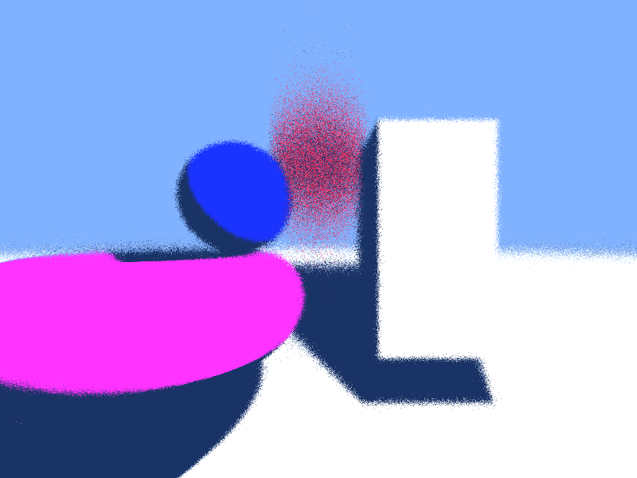

# MGSI Ray Marching

A real-time ray marching and ray tracing engine in C++ and OpenGL, built for the MGSI course (geometric modeling and image synthesis) at the Université de Bourgogne.

Scenes are described with signed distance functions (spheres, cubes, tori, planes) combined in a CSG tree. Everything is rendered on the GPU in a fragment shader, and you can fly through the scene with a free camera.



## Features

- **Ray marching on the GPU**: signed distance functions evaluated in GLSL, one ray per pixel.
- **CSG tree**: union, intersection and difference of primitives. The C++ scene is encoded into matrices, floats and type ids and sent to the shader as uniforms.
- **Free camera**: move and look around in real time.
- **Temporal smoothing**: each frame is blended with the previous one in a framebuffer, which averages noisy rays.
- **Depth of field**: rays are jittered around a focal distance.
- **Motion blur**: moving objects are displaced randomly along their path for each ray, then smoothed over time.
- **Other shaders**: classic ray tracing, specular lighting, reflections, and a Mandelbrot fractal.

## Build

Tested on Ubuntu 24.04 with Mesa (OpenGL 4.6).

```bash
sudo apt install g++ make libsdl1.2-dev libglew-dev libglu1-mesa-dev
make
```

## Run

```bash
./main              # default ray marching scene (Shaders/shader.*)
./main raytracing   # ray tracing
./main specular     # specular lighting
./main DOF          # depth of field
./main mblur        # motion blur
./main mandelbrot   # Mandelbrot fractal
```

The argument is the name of a shader pair in `Shaders/` (`<name>.vert` and `<name>.frag`).

## Controls

Keys follow an AZERTY layout.

| Key | Action |
| --- | --- |
| Z / S | Move forward / backward |
| Q / D | Move left / right |
| Space / Left Shift | Move up / down |
| F | Toggle FPS mode |
| Esc | Quit |

## Project structure

| File | Role |
| --- | --- |
| `Projet.cpp` | Entry point: initializes the scene and renderer, runs the main loop, measures frame time |
| `Scene.*` | Stores objects and encodes the CSG tree for the shader |
| `Object.*`, `Objects/` | Base object (position, rotation, scale, material) and primitives |
| `CSG.h` | CSG tree nodes |
| `Renderer.*` | Shader and uniform setup, framebuffer rendering and temporal blending |
| `Camera.*` | Camera position, rotation and field of view |
| `Shaders/` | GLSL vertex and fragment shaders for each rendering mode |

A presentation of the design (in French) is in `MGSI Projet Ray Tracing.pdf`.

## Authors

University project. Moussa Traoré built most of the engine.